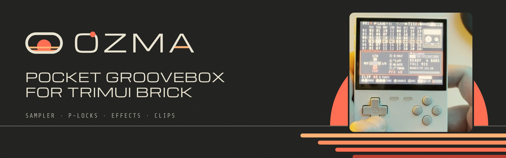
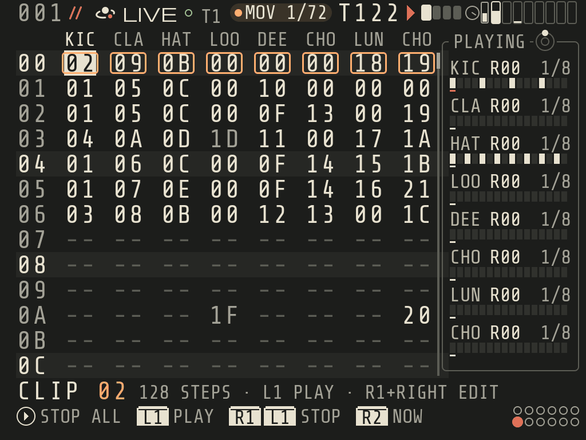
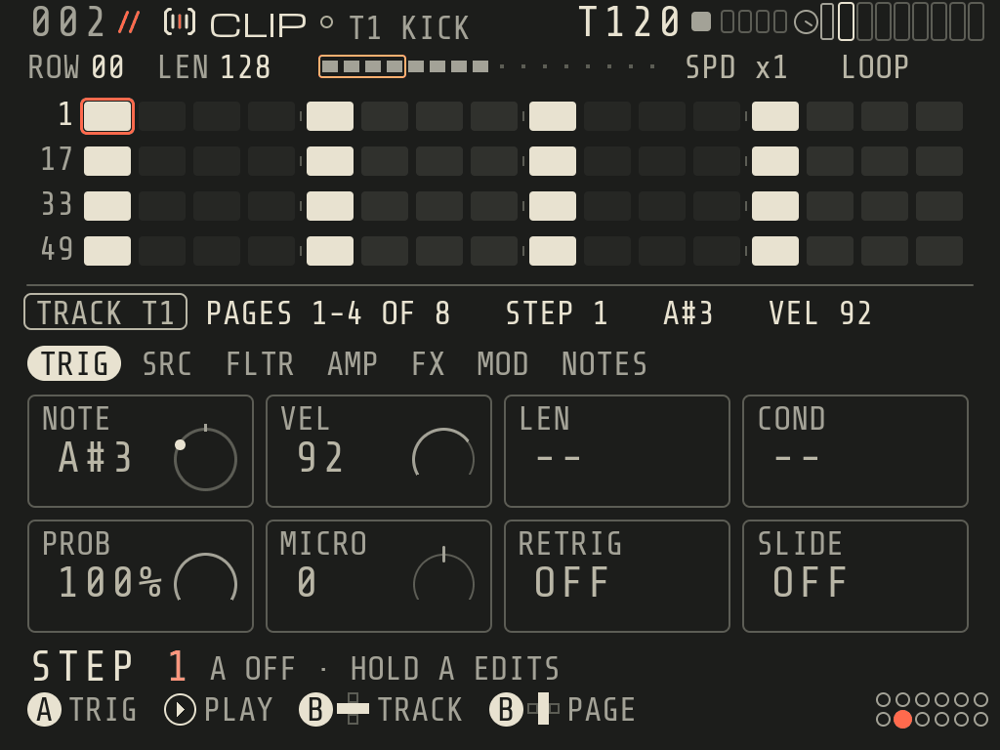
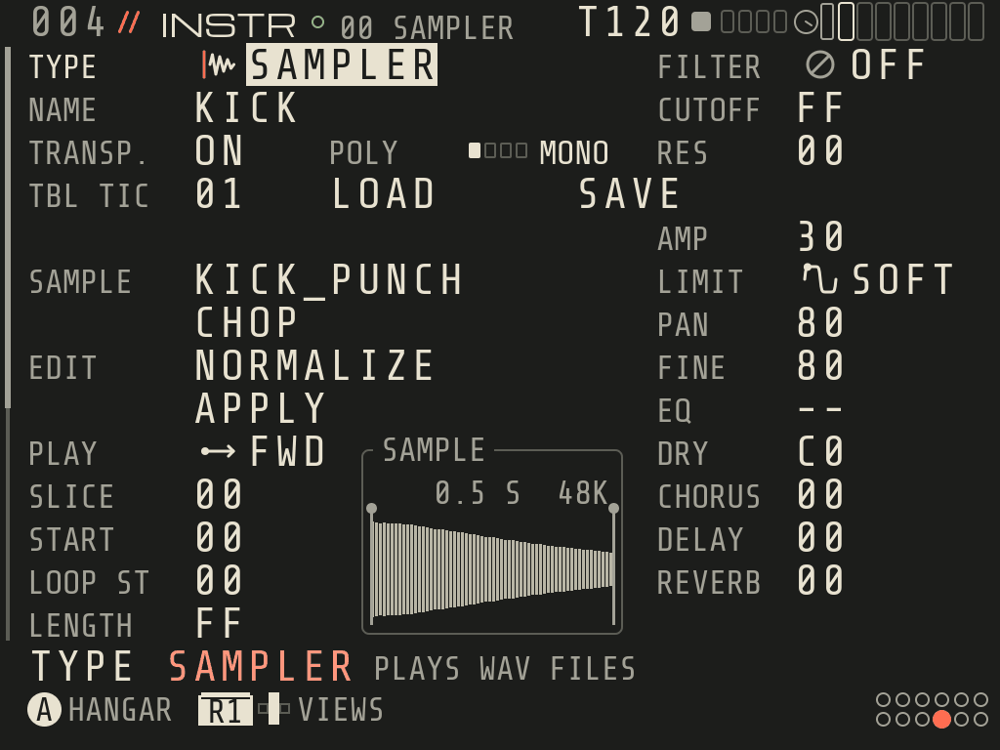
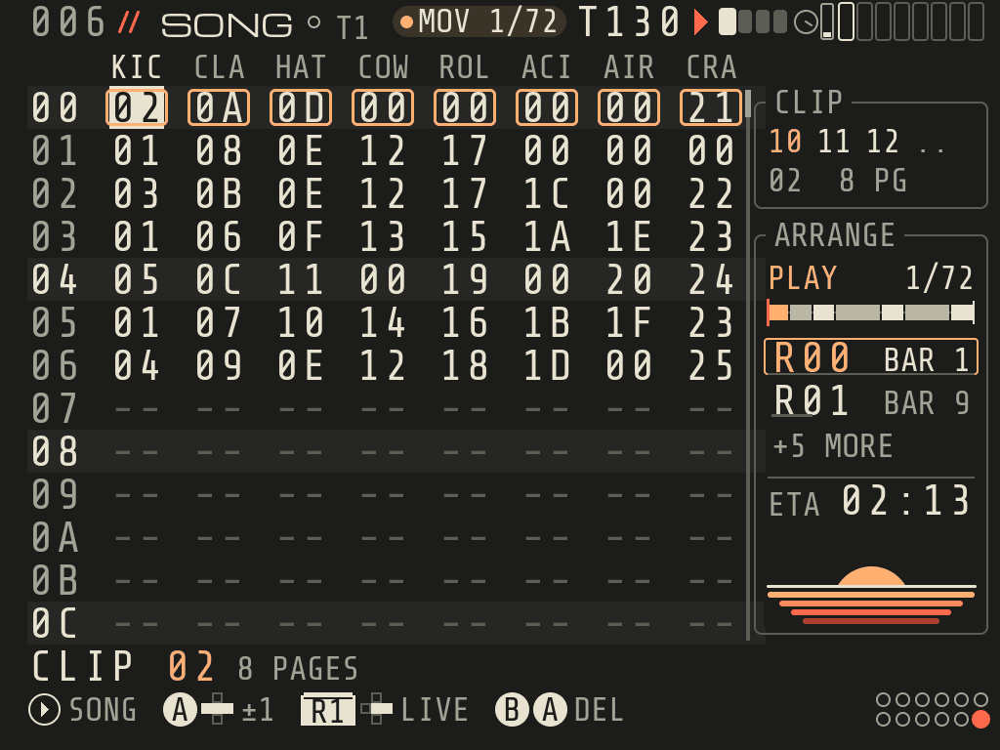
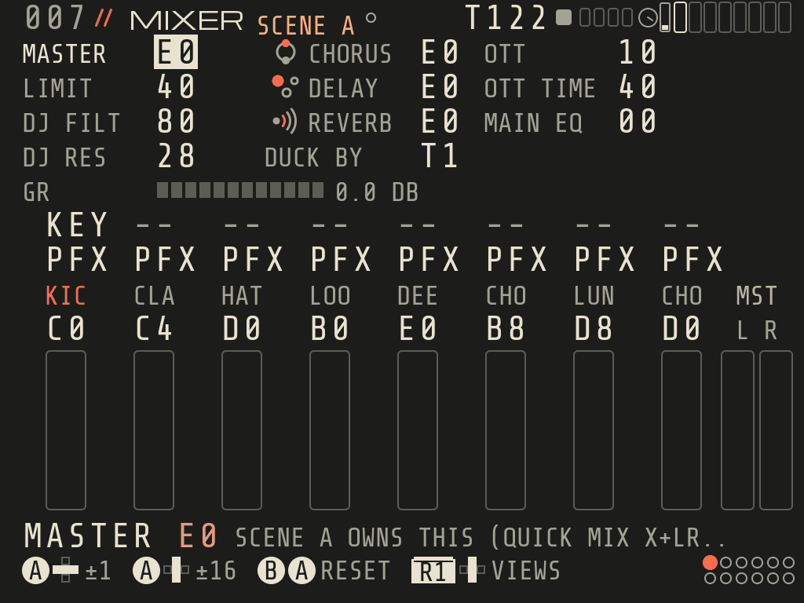
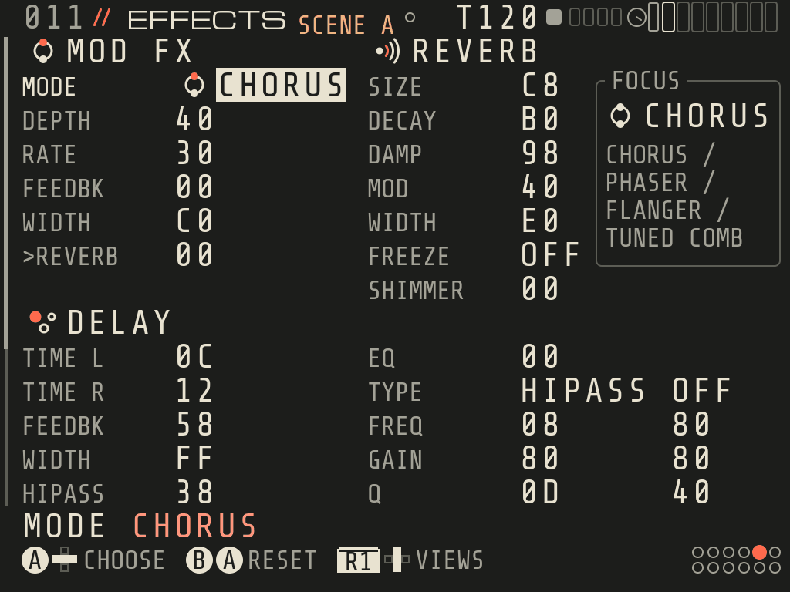
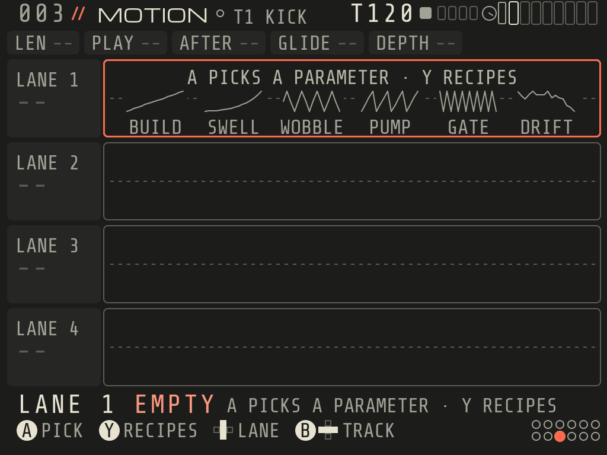

**A pocket groovebox and music tracker that runs on the TrimUI Brick itself.**
Write, jam and mix full songs on a handheld: no computer, no cables.

> **Open beta:** OZMA 0.8-beta.1 is out. It's free; please report anything odd on Discord.

## Features

- **8 tracks, tracker workflow.** STEP and LOOP tracks, a LIVE and SONG grid of clips, trig conditions,
  probability, micro timing, retrigs, slides, parameter and sound locks.
- **Instruments built in.** ATLAS, KEPLER, ORBIT, CLUSTER and LUNA synths, a SAMPLER with slices, warp and
  TO SAMPLER chops, and MIDI OUT.
- **Mix on the device.** Chorus, delay, reverb, master OTT, EQ, DJ filter and limiter; SCENES, PERFORM and QUICK MIX.
- **Play it live.** JAM plays the notes of a scale from the buttons; MOTION adds automation lanes to your clips.
- **BOUNCE.** Print a row to audio and keep playing it as a LOOP clip.
- **Three demo songs and OZMA KIT.** DEEP FIELD (deep house), REDSHIFT (techno) and ION DRIVE (drum and bass), made
  only with OZMA's own sounds, plus a drum and FX kit you may use in your own music.

<table>
<tr>
<td></td>
<td></td>
</tr>
<tr>
<td align="center"><b>CLIP</b>: steps, trigs and locks</td>
<td align="center"><b>SAMPLER</b>: slices, chops, warp</td>
</tr>
<tr>
<td></td>
<td></td>
</tr>
<tr>
<td align="center"><b>SONG</b>: arrange your clips</td>
<td align="center"><b>MIXER</b>: levels, sends, master OTT</td>
</tr>
<tr>
<td></td>
<td></td>
</tr>
<tr>
<td align="center"><b>EFFECTS</b>: chorus, delay, reverb</td>
<td align="center"><b>MOTION</b>: automation lanes</td>
</tr>
</table>

Screenshots from OZMA 0.8-beta.1 (1024×768, the Brick's screen).

## Quick start

| Brick OS | Status |
|---|---|
| spruce | Recommended, fully tested |
| Stock TrimUI OS, CrossMix | Experimental: please tell us how it works |
| NextUI / MinUI, Knulli | Not supported yet |

1. Download `OZMA-<version>.zip` from [itch.io](https://orumet.itch.io/ozma) or [Releases](https://github.com/Manticorees/OZMA/releases).
2. Turn the Brick off and put its SD card in your computer.
3. Unzip the file into the **root** of the card and allow it to merge folders.
   You get `App/OZMA` (the app and your data) and `Apps/OZMA` (the menu entry for the stock OS).
4. Put the card back, turn the Brick on and open **OZMA** from the Apps menu.
5. Press **MENU** for HELP, then RIGHT for **DEMOS** to hear what it can do.

The full guide is the [OZMA manual](https://orumet.com/manual): every screen, every button, every setting.

## Your files

Everything lives in `App/OZMA/data` on the SD card, shared by spruce and the stock OS.

| Folder | What's in it |
|---|---|
| `data/Songs` | Your songs (`.ozm`). Back this up now and then. |
| `data/Samples` | Your samples: **WAV only**, subfolders welcome. OZMA only looks here. |
| `data/Samples/OZMA KIT` | OZMA's own drums and FX, free to use in your music (not as a sample pack). |
| `data/Demos` | The demo songs. If you change one, SAVE writes your version to `Songs`. |

## Updating

Unzip the new version over the old one the same way. The zip never contains your songs or your own
samples, so they stay. In-app updates over Wi-Fi are planned; the manifest they will read is
[`update/latest.json`](update/latest.json).

**Check a download (optional):** each release has `OZMA-<version>.zip.sha256`.
Windows: `certutil -hashfile OZMA-0.8-beta.1.zip SHA256` · macOS / Linux: `shasum -a 256 OZMA-0.8-beta.1.zip`.
The result must match the `.sha256` file.

## Help and bug reports

- **Something broke?** Post in `#bugs` on [Discord](https://discord.gg/uX7gvn2Ary), one bug per post, with
  the OZMA version (`App/OZMA/VERSION.txt`), your Brick OS, what happened, and the files
  `App/OZMA/log.txt` and `App/OZMA/studio.log` (quit OZMA first, then take the SD card out).
- **Wi-Fi sync or file sharing stopped?** OZMA pauses them while it runs ("studio mode") and brings them back
  when you quit. After a crash, open and quit OZMA once more, or restart the Brick.
- See the [troubleshooting section](https://orumet.com/manual) of the manual for more.

## License

OZMA is free, closed-source software. You may download and use the released builds, and use OZMA KIT sounds in
your music, also commercially. You may not redistribute, modify or reverse-engineer OZMA. The full terms are in
`LICENSE.txt` inside the zip; open-source parts and fonts are listed in `THIRD_PARTY_NOTICES.txt`.

This repository holds releases and documentation only. OZMA's source code is not published.
